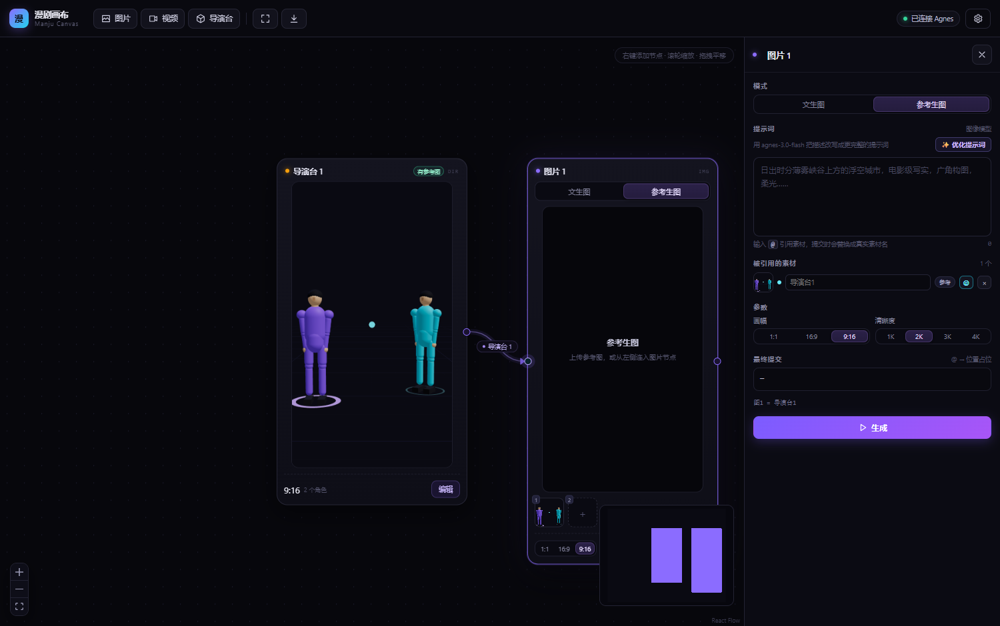
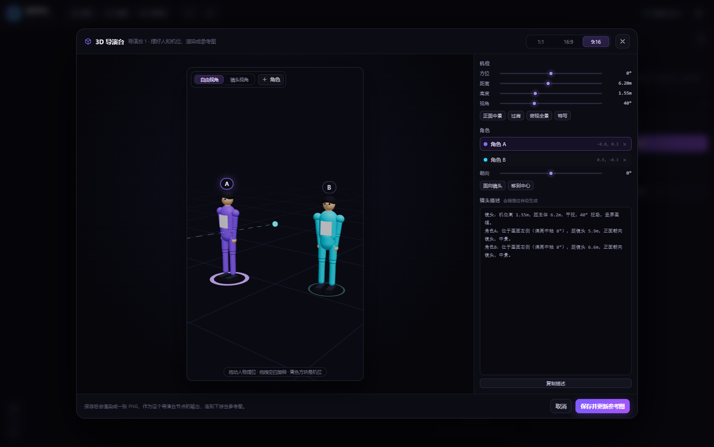
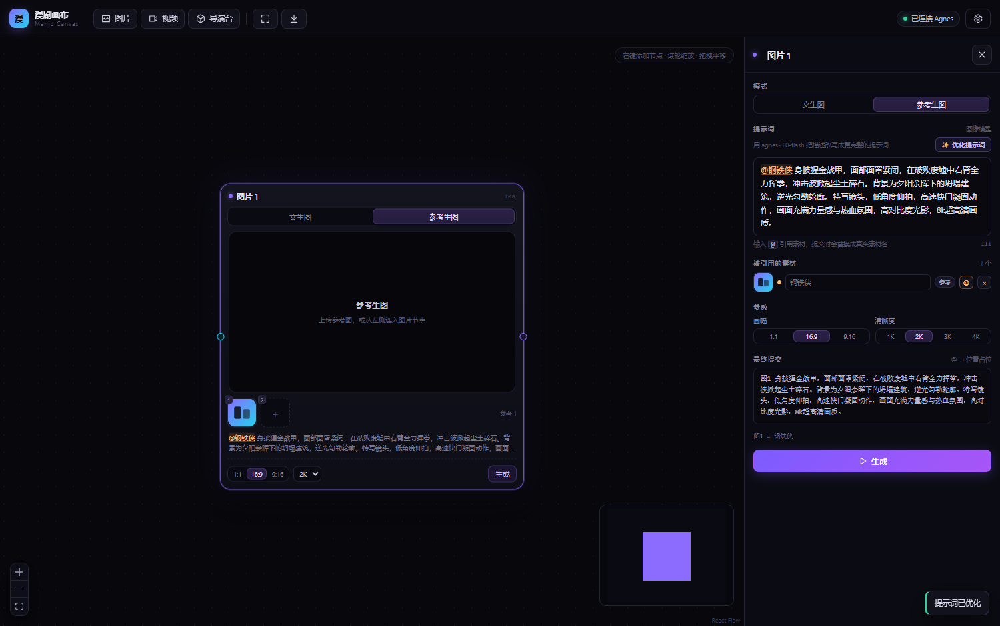
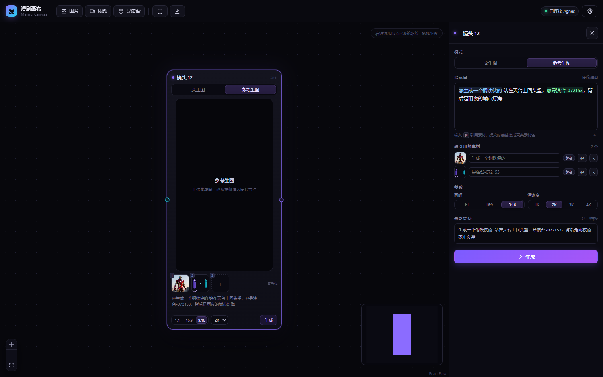

# 漫剧画布 · Manju Canvas

一个面向 **AI 漫剧（动态漫短剧）** 的节点画布：图片节点、视频节点、3D 导演台串在一起，走通「分镜 → 首帧 → 镜头片段」的生产链路。

接入 [Agnes AI](https://agnes-ai.com) 的三个模型：

| 能力 | 模型 | 接口 |
| --- | --- | --- |
| 文本 | `agnes-3.0-flash` | `POST /v1/chat/completions`（提示词优化） |
| 图片 | `agnes-image-2.5-flash` | `POST /v1/images/generations` |
| 视频 | `agnes-video-2.5-flash` | `POST /v1/videos` + `GET /agnesapi` 轮询 |



---

## 功能

- **节点画布**：右键添加、拖拽、连线、缩放平移；连线中间带来源标签，可溯源、可断开
- **图片节点**：文生图 / 参考生图（多图合成），清晰度 1K–4K × 画幅 1:1 / 16:9 / 9:16
- **视频节点**：文生视频 / 首尾帧（可一键对换）/ 参考（图≤5、音频≤3、合计≤8）
- **3D 导演台**：摆好人和机位，渲染成一张参考图，作为**源节点**接给下游
- **`@` 引用**：彩色标记素材，提交时按附图顺序替换成 `图N` / `<Picture N>` / `首帧`、`尾帧`
- **版本历史**：每个节点保留最近 24 版，可切换、可删除；切回旧版会自动同步给下游
- **提示词优化**：内置 `agnes-3.0-flash`，一键把粗糙描述改写成结构化提示词，且不破坏 `@` 引用
- **演示模式**：没配 API Key 也能跑通整条链路（返回占位素材），方便先看交互
- **本地优先**：Key 只在服务端，画布数据存浏览器 localStorage，素材存本地磁盘，不依赖任何云服务

## 截图

| 3D 导演台 | 提示词优化 |
| --- | --- |
|  |  |

| 彩色 @ 引用 |
| --- |
|  |

---

## 快速开始

**要求**：Node.js 18+（建议 20 / 22 / 24），npm 或 pnpm 都行。

```bash
git clone https://github.com/lhd996/manju.git
cd manju-canvas
pnpm install         # 仓库带 pnpm-lock.yaml，用 pnpm 版本最稳；也可以用 npm install
pnpm dev             # 或 npm run dev
```

打开 <http://127.0.0.1:5173>。

也可以不用 `npm run dev`，用自带脚本：

- **Windows**：双击 `dev.cmd` —— 会自己找 Node、清理上次残留的进程、启动后自动开浏览器，出错不会闪退
- **macOS / Linux**：`chmod +x dev.sh && ./dev.sh`

> 服务端用 `node --watch` 启动，改 `server/*.mjs` 会自动重启。

### 配置 API Key

三种方式，优先级从高到低：

1. **界面里配（推荐）**：右上角齿轮 → 填 Agnes API Key → 保存。写入 `data/config.json`，立即生效
2. **配置文件**：`data/config.json`，内容 `{"apiKey": "sk-..."}`，改完重启服务
3. **环境变量**：启动前 `set AGNES_API_KEY=sk-...`（macOS/Linux 用 `export`）

Key 只存在于服务端，不会进入浏览器请求，也不会写进导出的画布 JSON。`.gitignore` 已排除整个 `data/` 目录，**不会被提交到仓库**。

保存后顶栏状态会从「演示模式」变成「已连接 Agnes」。免费账户 **RPM 20**，服务端默认按 18 RPM 串行排队。

---

## 画布怎么用

- **右键空白处** → 添加图片节点 / 视频节点 / 导演台节点
- **拖右端口到左端口** 连线，线中间显示上游节点名
- **断开连线**：鼠标移到线上，标签旁浮出 `×`，点它断开（同时清空下游对应槽位）
- **选中节点** → 右侧检查器改提示词、参数、素材名
- **提示词里输入 `@`** → 弹出当前节点可引用的素材（自己的上传 + 上游传下来的）
- 拖拽平移、滚轮缩放、`Delete` 删除、`Ctrl` 框选
- 工具栏可导出 / 导入画布 JSON

### 图片节点

| 模式 | 上游输入 | 说明 |
| --- | --- | --- |
| 文生图 | **不接受**（左侧端口隐藏） | 纯提示词出图，右侧输出可给下游当参考 |
| 参考生图 | 接受 | 槽位默认 1 个；点 `+` 上传；上游连线自动填进空槽并补一个新空槽 |

### 视频节点

| 模式 | 输入 | 限制 |
| --- | --- | --- |
| 文生视频 | 无 | — |
| 首尾帧 | 最多 2 张（上传或上游） | 首 / 尾帧之间可一键 `⇄` 对换 |
| 参考 | 图片 ≤ 5、音频 ≤ 3、合计 ≤ 8 | 前端 + 服务端双重校验 |

固定 720P（Flash 限制），时长 4–12 秒，画幅 1:1 / 16:9 / 9:16。视频节点**只有输入端口**，没有下游。

### `@` 引用怎么落到 API

提示词里写 `@素材名`，提交前按模式替换：

| 场景 | `@钢铁侠` 最终变成 |
| --- | --- |
| 参考生图 | `图2` —— 只回填位置占位，不带素材名（模型按附图顺序理解） |
| 首尾帧 | `首帧` / `尾帧` |
| 参考生视频 | `<Picture 1>`，序号与 `images` 数组严格对应；音频为 `<Audio 1>` |

「最终提交」会实时显示替换结果，下面还有一行 `图1 = 图片1 · 图2 = 图片3` 的映射提示（只是界面提示，不发给模型）。

### 导演台节点


导演台是**源节点**：没有输入，只有右侧输出，产物是一张渲染出来的 PNG。

- 工具栏「导演台」→ 新建节点并自动打开编辑器
- 拖动小人摆位、改机位（方位 / 距离 / 高度 / 视角）、四个预设；底部自动生成中文镜头描述
- 保存时以长边 1024 渲染成 PNG，作为该节点输出；连到下游即可当参考图
- 切换画幅会自动重算机距，保证人物不出画

---

## 换一台电脑继续用

1. `git clone` + `npm install`
2. 配好 API Key
3. **画布数据不在仓库里**：它存在浏览器 localStorage，素材存在 `data/assets/`。要迁移就两样一起带：
   - 旧机器上「导出画布 JSON」（工具栏下载按钮）
   - 把旧机器的 `data/assets/` 目录整个拷到新机器同名位置
   - 新机器上「导入画布 JSON」

> `data/` 被 git 忽略是故意的：里面既有 API Key，也有生成的大图大视频。

---

## 目录结构

```
server/
  index.mjs     Express：生成代理、素材落库、视频任务轮询、提示词优化、演示模式
  agnes.mjs     Agnes 客户端（图像同步 / 视频异步 / 文本 chat）
  mock.mjs      演示占位素材（服务端生成 SVG）
  store.mjs     配置、素材索引、原子命名
src/
  store.ts      Zustand：节点、连线、运行、上游产物下传、持久化
  api.ts        前端请求封装
  lib/
    prompt.ts   媒体解析、@ 引用替换、颜色分配
    director.ts 导演台默认参数
  components/
    Canvas.tsx          画布、右键菜单、连线校验
    nodes/ImageNode.tsx
    nodes/VideoNode.tsx
    nodes/DirectorNode.tsx
    edges/AssetEdge.tsx 可断开的自定义连线
    Inspector.tsx       右侧检查器
    PromptEditor.tsx    @ 自动补全 + 彩色高亮
    DirectorStage.tsx   导演台编辑器
    DirectorScene.tsx   R3F 场景、人偶、截图
scripts/      开发期的验证脚本（Puppeteer，可选）
docs/         设计文档与截图
```

几个关键实现：

1. **连线即数据**：每个输入槽记录 `edgeId + fromNodeId`，删边自动清槽，不会出现"线没了但参数还在"
2. **上游产物下传**：上游生成成功后，把新素材写进所有引用它的下游输入；改名时还会把下游提示词里的 `@旧名` 同步改掉
3. **任务在服务端**：视频 job 由服务端轮询，页面刷新也能续查（服务端重启会丢内存中的 job）
4. **优先用公网 URL，本地素材自动内联**：视频接口要公网地址，Agnes 生成的素材自带 `remoteUrl`；导演台渲染图、上传图这类纯本地素材会自动转成 `data:` URI 发过去（实测 1.7MB base64 也可用），超过 8MB 才需要自己配公网地址

---

## 已知限制

- **没有 TTS**：三个模型都不出语音，成片配音要另接（`Asset.kind = 'audio'` 已预留）
- **视频仅 720P / 4–12 秒**：长镜头要靠首尾帧链式衔接
- **角色一致性靠参考图**：没有 LoRA / 人脸锁定，多镜头之间仍会漂移，需要人工挑片
- **超大本地素材**：单张超过 8MB 的本地图片无法内联给视频接口，需要在设置里配一个公网可访问的地址（如 cloudflared 隧道 / R2）
- **单机单用户**：没有账号体系，画布数据在浏览器本地

## 常见问题

**`fetch failed` / `连接 apihub.agnes-ai.com 失败（ECONNRESET）`**
服务端到 Agnes 的连接层失败，通常是网络瞬断或平台拥塞，不是 Key 的问题。会自动重试并带上原因码。国内直连不稳时可以让服务端走代理：

```powershell
set CANVAS_PROXY=http://127.0.0.1:7897   # 换成你的代理端口
dev.cmd
```

> Node 的 `fetch` **不读系统代理**，所以必须这样显式指定；设置面板底部会显示当前网络出口。

**`image queue is full` / `video queue full`**
平台侧队列满了。图片会自动退避重试 2 次；视频不重试，直接提示手动重跑。

**`too many video status queries`**
平台对状态查询限频。服务端全局至少 6 秒查一次（`AGNES_POLL_GAP_MS` 可调），被限流会等更久继续查，不会判失败。

**端口被占用**
`dev.cmd` 会识别并清理"属于本项目"的残留进程；如果被别的程序占用，会提示端口号。

**改完服务端代码没生效**
正常情况 `--watch` 会自动重启；如果没生效，把 `dev.cmd` 窗口关掉重开。

---

## 下一步

1. 一句话 → 分镜表（文本模型 + JSON schema）→ 一键铺满画布
2. 接 TTS + 字幕，画布底部加时间线，FFmpeg 直接出片
3. 批量操作：框选多个节点批量重跑 / 批量换参考
4. 角色库：跨项目复用角色卡与场景卡

## 许可

暂未指定开源许可证。如果用到了别人的作品或素材，请自行确认版权。

> 界面上保留了 React Flow 的署名（其许可要求）。
